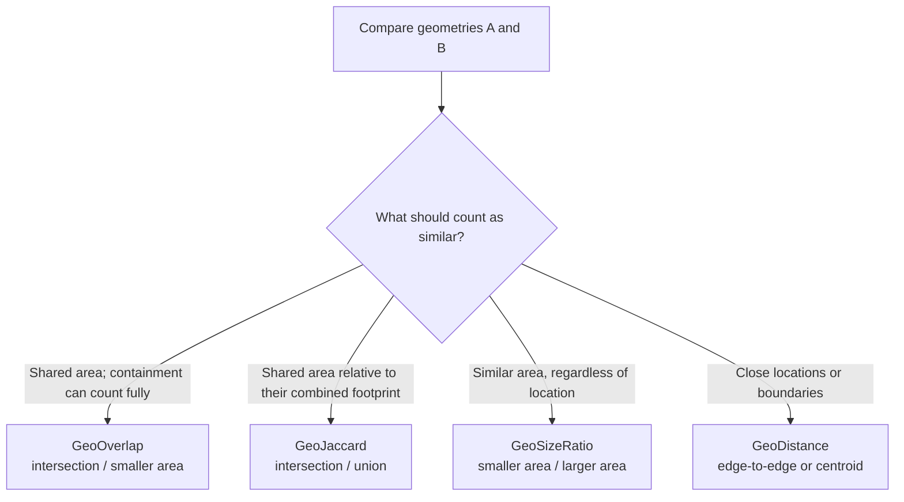
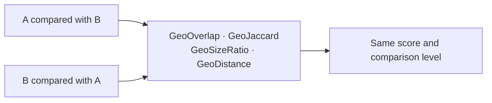

# GeoSplink

[](https://github.com/tjavanderwielen/geosplink/actions/workflows/tests.yml)

Geospatial comparator classes to supplement [Splink](https://github.com/moj-analytical-services/splink) record linkage.

Provides SQL-based comparison levels for matching records based on geometric properties, designed to slot directly into Splink's `SettingsCreator` alongside standard comparators.

## Structure

Mirrors Splink's own library structure:

| File | Contents |
|------|----------|
| `geo_comparison_level_library.py` | Individual level classes (`GeoNullLevel`, `GeoOverlapLevel`, etc.) |
| `geo_comparison_library.py` | Full comparator classes (`GeoOverlap`, `GeoJaccard`, etc.) |

## Comparators

### `GeoOverlap(col_name, thresholds=[0.9, 0.5], bbox_prefix=None)`
Overlap coefficient: `intersection / min(area_l, area_r)`. A small geometry fully inside a large one scores 100%, so this is useful when one dataset has coarser geometries than the other.

### `GeoJaccard(col_name, thresholds=[0.9, 0.5], bbox_prefix=None)`
Jaccard similarity (IoU): `intersection / union`. Symmetric. Preferred when both datasets have comparable geometry precision.

### `GeoSizeRatio(col_name, thresholds=[0.5, 0.25])`
Size ratio: `min(area_l, area_r) / max(area_l, area_r)`. Useful as an independent signal when geometries may not overlap but should be similar in scale.

### `GeoDistance(col_name, distance_threshold_or_thresholds, distance_type="euclidean", use_centroid=False, crs=None)`
Distance between two geometries (or their centroids, if `use_centroid=True`), compared against one or more thresholds. The `crs` parameter controls how thresholds are interpreted:

- **Projected CRS** (e.g. `crs='EPSG:28992'`): distance is computed directly; thresholds are in metres.
- **Geographic CRS** (e.g. `crs='EPSG:4326'`): geometries are reprojected to Web Mercator (EPSG:3857) before computing distance; thresholds are in metres (approximate — accuracy degrades above ~60° latitude).
- **Unrecognised or omitted CRS** (`crs=None` or an EPSG code not in geosplink's known list): falls back to Euclidean distance in the geometries' native coordinate units, and emits a `UserWarning`.

See `src/geosplink/crs.py` for the full list of recognised geographic and projected EPSG codes.

### Choosing a comparator



Overlap and Jaccard both require intersecting geometries; Jaccard penalises area outside the intersection more strongly. Size ratio ignores location, while distance measures proximity rather than shared area.

### Does swapping A and B change the result?

`score(A, B) == score(B, A)` for all four comparators. In particular, GeoOverlap is symmetric in its inputs: its smaller-area denominator means full containment scores 100% in either order. That containment behaviour is sometimes mistaken for directional scoring.



This follows from the formulas: intersection and union are unchanged by swapping the geometries; `min` and `max` are order-independent; and distance is the same in either direction. Exact-overlap and exact-distance levels are also unchanged.


## Usage

```python
from geosplink import GeoOverlap, GeoJaccard, GeoSizeRatio, GeoDistance, DuckDBAPI

settings = SettingsCreator(
    link_type="dedupe_only",
    comparisons=[
        GeoOverlap("geometry_wkt"),
        GeoDistance("geometry_wkt", [100, 500], crs="EPSG:4326"),
    ],
)

db_api = DuckDBAPI()  # installs and loads the DuckDB spatial extension automatically
```

Individual levels can also be composed into a `CustomComparison`:

```python
from geosplink import gcll
from splink.internals.comparison_library import CustomComparison

comparison = CustomComparison(
    comparison_levels=[
        gcll.GeoNullLevel("geometry_wkt"),
        gcll.GeoJaccardLevel("geometry_wkt", threshold=0.8),
        gcll.GeoAnyOverlapLevel("geometry_wkt"),
    ]
)
```

## Requirements

- [Splink](https://github.com/moj-analytical-services/splink)
- DuckDB with the [spatial extension](https://duckdb.org/docs/extensions/spatial.html). Use `geosplink.DuckDBAPI` in place of Splink's `DuckDBAPI` and it will automatically run `INSTALL spatial; LOAD spatial;` for you — no manual setup required.

The geometry column must contain WKT strings.

`GeoOverlap` and `GeoJaccard` run a cheap bounding box test before the expensive intersection, which discards most non-matching pairs early. By default the bounding boxes are computed inline from the WKT. If your data already has bounding box columns, pass `bbox_prefix` to use them instead, which is faster as the WKT does not have to be parsed again for every pair:

| Column | Description |
|--------|-------------|
| `{bbox_prefix}_minx` | Minimum x (longitude) of bounding box |
| `{bbox_prefix}_miny` | Minimum y (latitude) of bounding box |
| `{bbox_prefix}_maxx` | Maximum x (longitude) of bounding box |
| `{bbox_prefix}_maxy` | Maximum y (latitude) of bounding box |

```python
# e.g. in DuckDB: ST_XMin(ST_GeomFromText(geometry_wkt)) AS bbox_minx, ...
GeoOverlap("geometry_wkt", bbox_prefix="bbox")
```

Splink expects `_l` / `_r` suffixed versions of these in the comparison table. Rows with a NULL bounding box value never pass the pre-filter, so they fall through to the "no overlap" level.

## Notes

**u-probability estimation:** Splink's `estimate_u_using_random_sampling()` will produce near-zero observations for overlap levels, since random non-matching pairs almost never overlap geometrically. Set u-probabilities manually via `.configure()`:

```python
GeoOverlap("geometry_wkt").configure(
    u_probabilities=[0.9999, 0.00002, 0.00003, 0.00003, 0.00002]
    # null, exact, >=90%, >=50%, any overlap — no overlap is last (not listed)
)
```

**Dialect support:** All SQL targets DuckDB spatial functions. Other backends (Spark, Postgres/PostGIS) are not yet supported.

**CRS:** Geographic and projected CRSes are recognised by EPSG code for `GeoDistance` (see `src/geosplink/crs.py` for the full list, e.g. `EPSG:4326`, `EPSG:28992`, UTM zones, etc.). Recognised geographic CRSes are reprojected to Web Mercator before computing distance; recognised projected CRSes are used directly. Unrecognised or omitted CRSes fall back to Euclidean distance in the geometries' native coordinate units, with a `UserWarning`. `GeoOverlap`, `GeoJaccard`, and `GeoSizeRatio` do not use CRS and assume geometries are already in a consistent CRS.